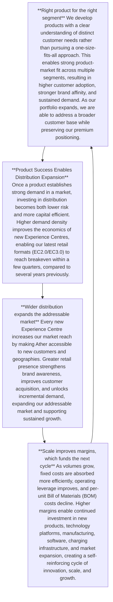

### **Ather Edge**

## **Ather’s right to win**

Ather’s core strengths are built on these pillars: pioneering technology, a software-defined ecosystem powered by AtherStack, and a premium multi-segment positioning rooted in superior quality and ownership. We scale this foundation through flexible, shared technology platforms and a capital-efficient model built to balance market expansion with financial discipline.

Our competitive advantage is not any single feature or product, but the way these strengths combine to create structural advantages that reinforce one another.

flow_chart: A circular process diagram showing the relationship between product success, distribution, and scale.

## **Structural Advantages powering the edge**

### **1. Vertical Integration**

Ather designs and develops most of its core technologies in-house, including the vehicle architecture, battery management system, power electronics, software, and vehicle operating system. This integrated approach enables faster product development, tighter system optimisation, and greater control over quality and performance.

#### **The Magnet Crisis: Vertical Integration in Action**

In Q2 FY26, China’s restrictions on rare earth magnet exports disrupted global EV supply chains, affecting the availability of traction motors across the industry, including at Ather. The disruption resulted in a one time revenue impact of ₹24.52 crores and was resolved within the quarter.

The speed of recovery reflected a structural advantage. Because Ather owns the core electronics architecture, our engineering teams were able to rapidly requalify component specifications without relying on external suppliers. Control over the battery management system enabled us to recalibrate vehicle performance at the system level, preserving the customer experience while navigating supply constraints. This is where the value of vertical integration becomes most evident. It is not in stable conditions, but when the operating environment is under stress.

This was not the first time our integrated engineering model has been tested. From semiconductor shortages to evolving regulatory changes, each disruption has strengthened our products, processes, and supply chain architecture. Many of the design choices in the EL platform, including lower component complexity, modular architecture, and reduced single source dependencies, are outcomes of these learnings. Rather than simply responding to disruptions, we systematically engineer greater resilience into every successive product generation.

As supply chains become increasingly shaped by geopolitical shifts, commodity volatility, and rapid technology transitions, the ability to adapt quickly is becoming a lasting competitive advantage. Our integrated technology stack and deep in house engineering capabilities enable us not only to navigate uncertainty, but to emerge stronger from it, reinforcing the resilience of both our products and our business

### **2. Ecosystem Approach**

Ather has built an integrated ecosystem that extends beyond the scooter, combining software, charging infrastructure, accessories, and connected services into a seamless ownership experience. At its core is AtherStack, the company’s proprietary software platform, built into the vehicle architecture from the outset. By integrating hardware, firmware, the operating system, cloud services, and customer applications, AtherStack enables connected features, over-the-air updates, advanced ride assistance, and continuous software improvements throughout the life of the vehicle.

This is complemented by Ather Grid, one of India’s largest fast-charging networks for electric two-wheelers, and the growing LECCS ecosystem, which extends charging access beyond Ather-owned infrastructure. Together with smart accessories and connected services, they strengthen the ownership experience, deepen customer engagement, and create recurring revenue opportunities as our installed base grows.

### **3. Operational efficiency or Capital-Efficient Distribution**

Ather has developed a scalable distribution model that combines disciplined network planning with a strong dealer ecosystem. Standardised Experience Centre formats and integrated deployment of retail, service, and charging infrastructure enable efficient expansion across geographies. In FY26, doubled our network from 351 to 700 experience centres, with more than 75% opened by existing dealer partners. This reflects the strength of our dealer network and the capital-efficient nature of our expansion model.