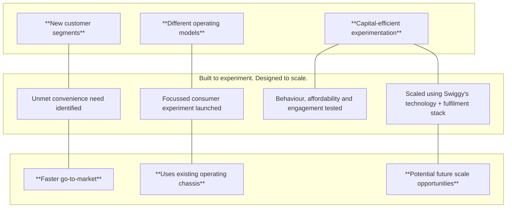

### **Platform Innovations**

## **Expanding Convenience Through Innovation**

**Some conveniences need a fresh playbook. Platform Innovations is where we test new formats, price points and operating models to open up new consumer segments and future growth pools. Leveraging our existing technology stack, fulfilment network and operating capabilities, these experiments allow us to move fast, learn quickly and scale what works.**

photo: person working on a laptop with code visible on screen

logo: toing

Toing was introduced during the year as a focussed experiment for affordable meals and budget-first consumption missions. Built for students and early-jobbers, the platform explores a different marketplace model for low-AOV food occasions while leveraging Swiggy’s scaled technology and operational stack. Affordability remains one of the largest unlocks for food delivery penetration in India, and Toing allows us to test new approaches while expanding the category itself.

### **CREW**

Another platform innovation during the year was the launch of Crew, a concierge-style assistance platform designed to help users plan, coordinate and simplify everyday tasks and experiences. From reservations and errands to travel planning and everyday assistance, Crew extends our convenience proposition into moments where users need more than a transaction.

flow_chart: Process flow diagram showing the progression from identifying unmet convenience needs to scaling using Swiggy's technology.

#### **KPIs**
INR Crores, unless specified otherwise

#### **Gross Revenue**\* and **Adjusted EBITDA** — FY23 to FY26; \* Also referred to as 'Adjusted Revenue'

<table><tr><th>Period</th><th>Gross Revenue* (INR Crores)</th><th>Adjusted EBITDA (INR Crores)</th></tr>
<tr><th>FY23</th><td>389</td><td>(416)</td></tr>
<tr><th>FY24</th><td>214</td><td>(119)</td></tr>
<tr><th>FY25</th><td>152</td><td>(75)</td></tr>
<tr><th>FY26</th><td>61</td><td>(197)</td></tr></table>